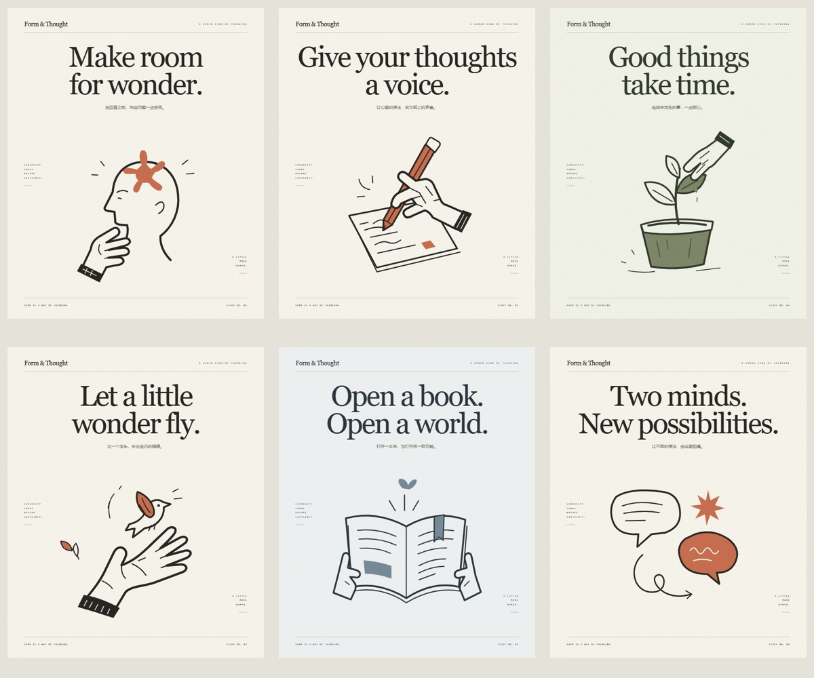
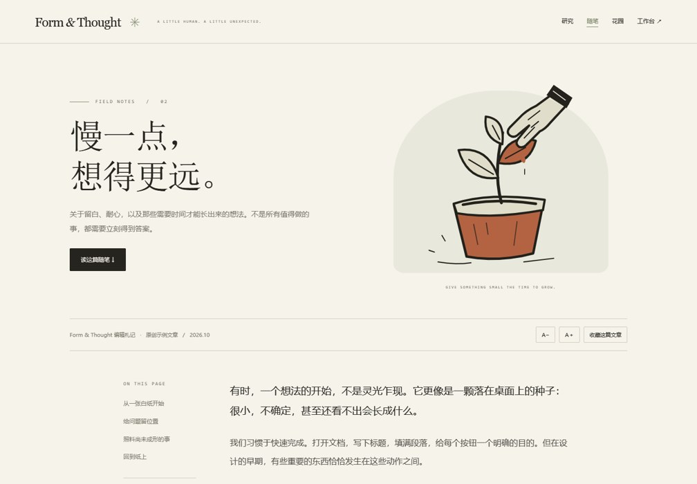
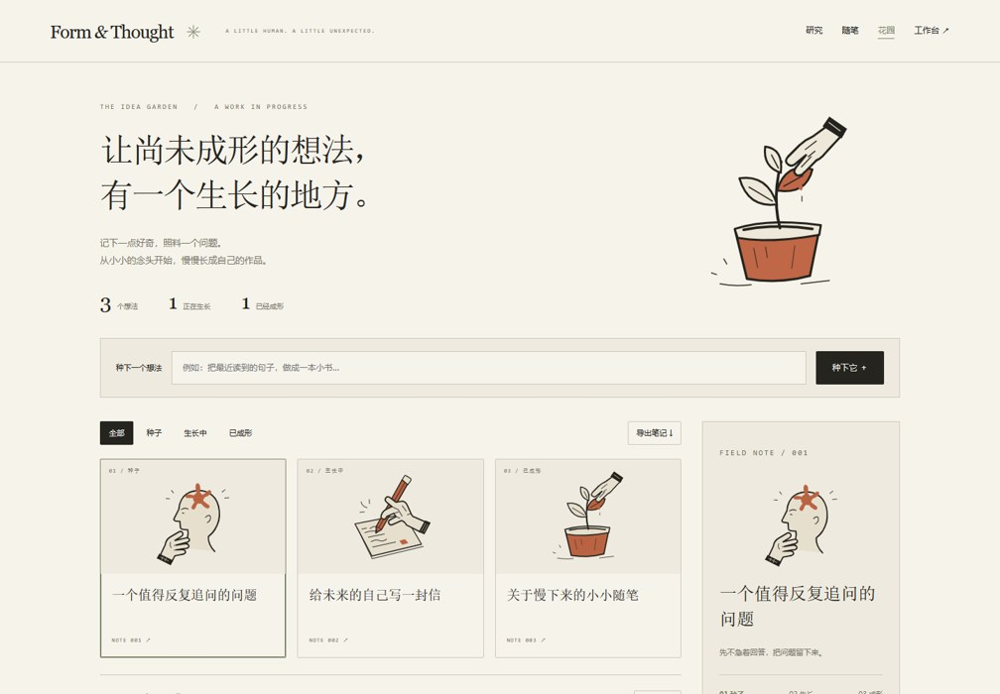

# Anthropic Visual Studio

**一句话启动，从视觉设计到可运行网页。** An independent, Claude-inspired design skill with an offline starter, editable original SVGs, motion controls, and browser verification.



```text
用 $anthropic-visual-studio 做一个 AI 研究工具首页，
要纸感排版、思考主题插画、轻微鼠标动效，并适配手机。
```

## 包含什么

- 纸色、编辑式排版、留白和细线的设计方法；支持已有网页改造与参考对照。
- 六幅原创 MIT 具象 SVG：思考、书写、生长、灵感、阅读、对话；配色、轻微动效、暂停与 reduced-motion。
- 海报工作台：文字编辑、缩放、纸纹、辅助线、恢复初始、插画和整张海报 SVG 下载。
- 六张完整海报、三种独立应用示例、离线总览；素材检索、页面生成、Playwright 验证和可选本地素材导入。

**公开版不含 Anthropic 官方插画、其描摹复刻及三份专有字体。** 默认使用原创示例和系统字体；原私人研究包独立保留，可在自己的机器导入。公开版不是官方项目，也不承诺任意画面一比一还原。

## 安装为技能

将仓库目录保存为 Codex 的 `skills/anthropic-visual-studio`。通常位置是用户目录下 `.codex/skills/anthropic-visual-studio`。已有同名技能时先备份或安装到另一个环境，不要覆盖私人素材版。

```sh
git clone https://github.com/Hj714110-oss/anthropic-visual-studio.git anthropic-visual-studio
```

将该文件夹放入技能目录后，新建或重新载入聊天，使用 `$anthropic-visual-studio`。其他支持 SKILL.md 的客户端需按各自规则配置技能目录。

**下载或克隆后，双击 `examples/index.html` 打开完整总览。** 海报工作台入口为 `examples/site/index.html`，全部示例无 CDN、无构建步骤，断网也能运行。

## 用在网站上是什么样子？

| 研究阅读页 | 长文章 | 互动灵感花园 |
| --- | --- | --- |
| [](examples/paper/index.html) | [](examples/article/index.html) | [](examples/garden/index.html) |
| 摘要 / 方法标签、图示切换、引用下载 | 阅读进度、字号、收藏保存 | 新建想法、阶段筛选、成长、本地保存、JSON 导出 |

GitHub 文件页展示源代码；运行请下载后打开对应 HTML。论文内容是明确标记的设计演示，不是实际研究成果。花园数据保存在本机浏览器，没有账号或服务器同步。

```text
用 $anthropic-visual-studio 把这篇论文做成研究阅读页，保留真实引用，支持图示切换。
用 $anthropic-visual-studio 给这篇文章设计纸感长文页面，加入书写插画和阅读设置。
用 $anthropic-visual-studio 做一个互动灵感花园，支持记录想法、分类、本地保存与导出。
```

六张主题海报位于 `examples/posters/`，保留可编辑文字与路径。导出不包含动画、纸纹及字体文件；系统字体在不同软件中可能呈现不同字形。

## 本地运行

需要 Python 3.10+，生成和检索脚本仅使用标准库。

```sh
python scripts/catalog.py --theme thinking --editable
python scripts/scaffold.py --out output/site --title "让想法，自在生长。" --motion gentle
```

双击 `output/site/index.html` 即可离线打开。模板是起点，应按真实产品修改布局和业务交互。

## 浏览器检查

```sh
python -m pip install -r requirements-dev.txt
python -m playwright install chromium
python scripts/verify_page.py output/site/index.html --out qa --starter --channel chromium
```

Windows 已安装 Edge 时可使用 `--channel msedge`。报告列出实际检查范围；不等同于任意业务验收或像素级复刻保证。

## 导入已有私人素材包

```sh
python scripts/import_local_assets.py --from /path/to/extracted-private-skill
python scripts/catalog.py --id HAND-11
python scripts/scaffold.py --out output/private-site --asset HAND-11
```

导入结果位于被 Git 忽略的 `assets/local/`，不覆盖公开素材。生成的网页可能包含导入资源，公开发布前需单独确认其权限。具体格式见 [素材说明](references/assets.md)。

## 已验证

- 5 项标准库脚本测试：检索、原图哈希、有效几何、输出保护与参数处理。
- Windows Edge 实测：海报工作台 36 项离线检查；三种应用 37 项离线检查。
- 覆盖海报 / SVG / BibTeX / JSON 下载、文字编辑、缩放、实际状态变化、重载保存、动画与暂停、键盘、减少动态效果、360/390px 布局和资源请求。
- 这些是本次测试结果，不保证任意修改后的页面自动通过。

```sh
python -m unittest discover -s tests -v
python scripts/verify_examples.py --out qa-apps --channel msedge
```

## 许可证

代码、规则与本仓库原创示例采用 [MIT](LICENSE)。第三方或本地导入内容不因此获得 MIT 授权，见 [第三方说明](THIRD_PARTY_NOTICES.md)。Anthropic / Claude 名称仅用于描述视觉参考。
