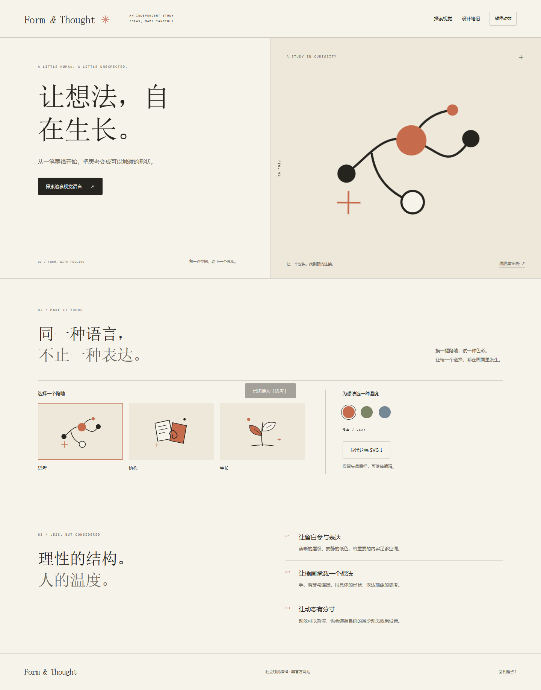

# Anthropic Visual Studio

**一句话启动，从视觉设计到可运行网页。** An independent, Claude-inspired design skill with an offline starter, editable original SVGs, motion controls, and browser verification.



```text
用 $anthropic-visual-studio 做一个 AI 研究工具首页，
要纸感排版、思考主题插画、轻微鼠标动效，并适配手机。
```

## 包含什么

- 纸色、编辑式排版、留白和细线的设计方法；支持已有网页改造与参考对照。
- 三份原创 MIT SVG 示例；配色、插画切换、鼠标视差、暂停与 reduced-motion。
- 实际 SVG 下载、原始文件说明、离线页面；无构建工具或 CDN 依赖。
- 素材检索、页面生成和 Playwright 验证脚本，以及可选本地素材导入。

**公开版不含 Anthropic 官方插画、其描摹复刻及三份专有字体。** 默认使用原创示例和系统字体；原私人研究包独立保留，可在自己的机器导入。公开版不是官方项目，也不承诺任意画面一比一还原。

## 安装为技能

将仓库目录保存为 Codex 的 `skills/anthropic-visual-studio`。通常位置是用户目录下 `.codex/skills/anthropic-visual-studio`。已有同名技能时先备份或安装到另一个环境，不要覆盖私人素材版。

```sh
git clone https://github.com/Hj714110-oss/anthropic-visual-studio.git anthropic-visual-studio
```

将该文件夹放入技能目录后，新建或重新载入聊天，使用 `$anthropic-visual-studio`。其他支持 SKILL.md 的客户端需按各自规则配置技能目录。

仓库还带有可直接打开的 `examples/site/index.html`，下载或克隆后双击即可体验。

## 本地运行

需要 Python 3.10+，生成和检索脚本仅使用标准库。

```sh
python scripts/catalog.py --theme thinking --editable
python scripts/scaffold.py --out output/site --title "让想法，自在生长。" --motion gentle
```

双击 `output/site/index.html` 即可离线打开。模板是起点，应按真实产品修改布局和业务交互。

## 浏览器检查

```sh
python -m pip install -r requirements-dev.txt
python -m playwright install chromium
python scripts/verify_page.py output/site/index.html --out qa --starter --channel chromium
```

Windows 已安装 Edge 时可使用 `--channel msedge`。报告列出实际检查范围；不等同于任意业务验收或像素级复刻保证。

## 导入已有私人素材包

```sh
python scripts/import_local_assets.py --from /path/to/extracted-private-skill
python scripts/catalog.py --id HAND-11
python scripts/scaffold.py --out output/private-site --asset HAND-11
```

导入结果位于被 Git 忽略的 `assets/local/`，不覆盖公开素材。生成的网页可能包含导入资源，公开发布前需单独确认其权限。具体格式见 [素材说明](references/assets.md)。

## 已验证

- 5 项标准库脚本测试：检索、原图哈希、有效几何、输出保护与参数处理。
- Windows Edge 实测：公开示例 28 项离线检查；导入私人库后的示例另通过 28 项。
- 覆盖 SVG 下载、状态切换、动画/暂停、键盘、减少动态效果、360/390px 布局与资源请求。
- 这些是本次测试结果，不保证任意修改后的页面自动通过。

```sh
python -m unittest discover -s tests -v
```

## 许可证

代码、规则与本仓库原创示例采用 [MIT](LICENSE)。第三方或本地导入内容不因此获得 MIT 授权，见 [第三方说明](THIRD_PARTY_NOTICES.md)。Anthropic / Claude 名称仅用于描述视觉参考。
